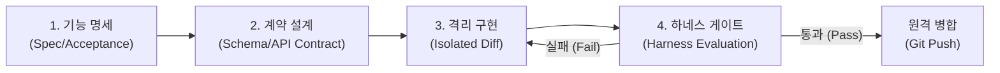

# 하네스 엔지니어링(Harness Engineering) 기반 개발 표준 및 다중 AI 협업 체계

> **스패셜티(SPATIAL T) 그룹웨어 시스템 품질 보증 및 회귀 방지 프레임워크**  
> 본 문서는 인간 개발자 및 다양한 AI 코딩 에이전트(Gemini, Claude, GPT, Cursor 등)가 협력할 때 발생할 수 있는 **의도치 않은 코드 수정(Side-effects)과 기능 퇴행(Regression)을 원천 차단**하기 위한 표준 개발 프로세스 및 하네스 엔지니어링 가이드라인입니다.

---

## 1. 하네스 엔지니어링(Harness Engineering)이란?

하네스 엔지니어링은 복잡한 소프트웨어를 외부에서 감싸는 **'자동화된 테스트 벤치 및 검증 케이지(Verification Harness)'**를 구축하여, 코드 변경 사항이 기존의 기능, 스키마 무결성, 보안 규칙을 훼손하지 않도록 보장하는 엔지니어링 규율입니다.

---

## 2. 4단계 표준 업무 프로세스

### [1단계] 기능 명세 (Specification)
- **목적**: 요구사항의 모호성을 제거하고, 개발 시작 전 완료 기준(Acceptance Criteria)을 확정합니다.
- **산출물**: 기능 명세서 (`docs/spec/SPEC-*.md` 또는 작업 티켓)
- **원칙**:
  - `Given - When - Then` (BDD 스타일)의 구체적인 동작 명시
  - 대상 사용자 역할(Role) 및 접근 권한(`ROLE_ADMIN`, `ROLE_EXEC`, `ROLE_PM`, `ROLE_STAFF`) 사전 정의
  - 기존 연계 기능 중 변경되어서는 안 되는 '보존 범위(Invariant)' 명시

### [2단계] 계약 설계 (Design & Contract)
- **목적**: 프론트엔드와 백엔드 간의 인터페이스 계약을 선행 정의하여 불일치를 방지합니다.
- **산출물**: DB ERD, DDL 마이그레이션 스크립트, TypeScript 인터페이스, REST API 명세
- **원칙**:
  - **문자열 비교 금지**: 모든 상태, 직급, 부서, 권한은 반드시 코드(`RoleCode`, `PositionCode`, `DepartmentCode`, `CommonCode`)로 설계
  - **엄격한 PK/FK 관계**: 이름 문자열 조인이 아닌 숫자 ID(기본키/외래키) 기반 관계 보장
  - **낙관적 락(Version) 필드 필수**: 동시 수정 충돌 방지를 위해 모든 엔티티에 `version` 유지

### [3단계] 격리 구현 (Isolated Implementation)
- **목적**: 요청받은 특정 기능 외에 인접 컴포넌트나 공통 로직이 오염되지 않도록 격리하여 수정합니다.
- **원칙**:
  - **최소 수정 원칙 (Minimal Diff)**: 요청 범위 외의 불필요한 포맷 변경이나 리팩토링 금지
  - **하드코딩 금지**: 화면에 노출되는 구분값, 코드, 단가 등은 전부 DB(`common_codes`, `master_data`)에서 조회
  - **전역 알림 모달화**: 네이티브 `window.alert()` / `window.confirm()` 사용을 금지하고, 디자인 시스템과 일체화된 비동기 `useModal()` (`showAlert`, `showConfirm`) 사용

### [4단계] 하네스 테스트 및 검증 (Harness Testing & Gate)
- **목적**: 코드가 작성된 직후 자동화된 검증 파이프라인을 통과하는지 확인 후 병합합니다.
- **검증 항목**:
  1. **타입 안전성 하네스**: `npx tsc --noEmit` ➔ 컴파일 에러 0건
  2. **백엔드 빌드 하네스**: `./backend/mvnw test-compile -DskipTests` ➔ 빌드 성공
  3. **데이터 무결성 하네스**: DB 마이그레이션 검증 및 FK 정합성 확인
  4. **UI 시각/기능 하네스**: Playwright를 이용한 헤드리스 브라우저 실행 및 스크린샷 검증

---

## 3. 다중 AI 협업(Multi-AI Collaboration) 원칙

다른 AI 모델(Claude, GPT, Cursor 등)이 프로젝트에 투입될 때 일관성을 유지하기 위해 다음 규칙을 준수해야 합니다.

1. **단일 진실 공급원(Single Source of Truth) 참조**:
   - DB 구조: [`export/schema/groupware_schema.sql`](file:///Users/ugwang-il/study/groupware/export/schema/groupware_schema.sql) 및 [`export/DATABASE_SPECIFICATION.md`](file:///Users/ugwang-il/study/groupware/export/DATABASE_SPECIFICATION.md)
   - 프론트엔드 모델: [`src/types/groupware.ts`](file:///Users/ugwang-il/study/groupware/src/types/groupware.ts)
2. **초기화 로직 덮어쓰기 금지**:
   - [`DataInitializer.java`](file:///Users/ugwang-il/study/groupware/backend/src/main/java/com/nexus/groupware/config/DataInitializer.java)는 DB에 레코드가 존재할 경우 절대 기존 데이터를 덮어쓰지 않아야 함.
3. **작업 완료 전 하네스 셀프 체크 필수**:
   - 커밋 전 반드시 프론트엔드 타입 체크 및 백엔드 컴파일을 수행하고 이상 없을 때만 커밋/푸시를 수행함.

